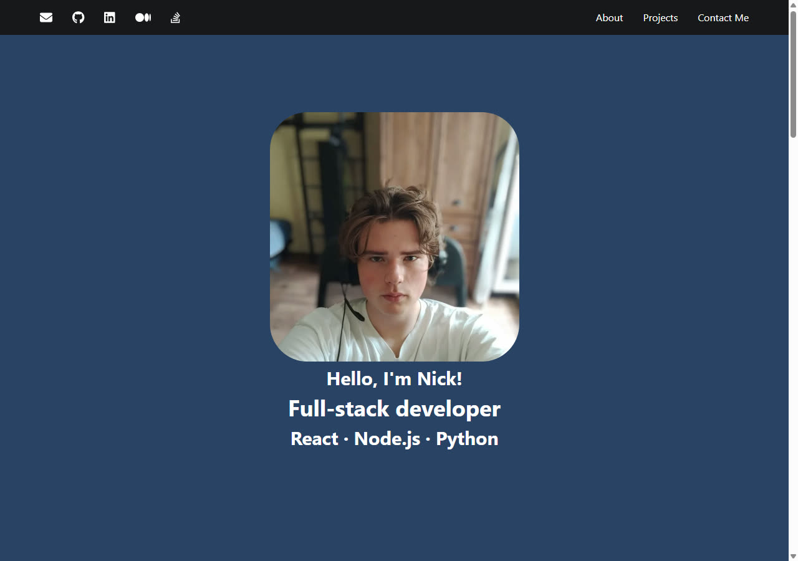

# Nick Babichau | Full-stack Developer

A React portfolio introducing my work, background, and ways to get in touch.

**Live portfolio:** [react-portfolio-vert-omega.vercel.app](https://react-portfolio-vert-omega.vercel.app/)

## About

I’m a full-stack developer based in Batumi, Georgia. I build responsive web
experiences and the APIs behind them.

- **Stack:** React, Node.js, Python
- **Languages:** English and Russian

## Projects

| Project | Description | Technologies | Live demo | Repository |
| --- | --- | --- | --- | --- |
| Weather Finder | Search cities for current weather and conditions. | HTML, CSS, JavaScript, wttr.in API | Source only | [GitHub](https://github.com/Baichau/weather-finder) |
| Little Lemon Restaurant API | Restaurant API for menus, carts, orders, and role-based access. | Python, Django REST Framework, Djoser, SQLite | Source only | [GitHub](https://github.com/Baichau/little-lemon-api) |
| Screed Masters | Responsive service website for floor-screeding work. | HTML, CSS, JavaScript, FormSubmit | [Live site](https://baichau.github.io/ScreedMasters-app/) | [GitHub](https://github.com/Baichau/ScreedMasters-app) |
| React Portfolio | This portfolio, with project links and direct email contact. | React, Chakra UI, JavaScript | [Live site](https://react-portfolio-vert-omega.vercel.app/) | [GitHub](https://github.com/Baichau/react-portfolio) |

## Screenshot



## Tech stack

- React 18 and Create React App
- Chakra UI
- JavaScript

## Getting started

### Prerequisites

- Node.js 14 or later
- npm

### Install and run

1. Clone the repository:

   ```bash
   git clone https://github.com/Baichau/react-portfolio.git
   cd react-portfolio
   ```

2. Install the locked dependencies:

   ```bash
   npm ci
   ```

3. Start the development server:

   ```bash
   npm start
   ```

   Open [http://localhost:3000](http://localhost:3000).

4. Create a production build:

   ```bash
   npm run build
   ```

5. Run the tests:

   ```bash
   npm test
   ```

The contact action opens a new message in your email application; it does not
submit a web form or require a third-party form-service account.
